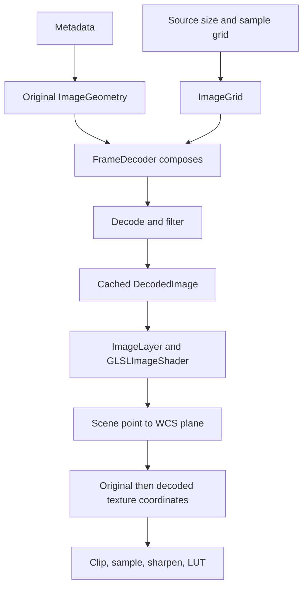

# Image coordinates from source to screen

JHV positions every decoded image through one pixel-coordinate model. Metadata maps original image
pixels to the WCS projection plane. A decoder grid says where the decoded samples lie in those original
pixels. The two compose into the geometry that filtering and texture sampling use.

The image footprint does not depend on the decode level. A coarser decode moves the sample positions
and shrinks the texture. It does not move detector masks, slits or cutout bounds.

## Pixel and texture conventions

Original image coordinates start at the upper-left edge. X increases along a row and Y follows the buffer
rows. An image of `W × H` pixels occupies `[0,W] × [0,H]`. The center of pixel `(i,j)` is `(i+0.5, j+0.5)`.
These coordinates are relative to the image, whatever its origin on a JPEG 2000 canvas.

Decoded buffers use the same convention on their own grid. Normalized texture coordinates divide buffer
coordinates by the buffer size, so decoded sample `(i,j)` is read at `((i+0.5)/Wr, (j+0.5)/Hr)`.

Texture row zero sits at texture coordinate `v = 0`. Where that row appears on screen follows from the
image geometry alone; the texture-coordinate path contains no vertical flip. `FITSData` writes FITS rows
into this top-down order, and `FitsMetaData` converts the reference pixel to match. Framebuffer coordinates
have their origin at the lower left and belong to the viewport and screen transforms, not to this model.

## Metadata to original image geometry

[`WcsInterpreter`](../src/org/helioviewer/jhv/metadata/WcsInterpreter.java) reads the FITS linear transform.
PC with CDELT takes precedence over CD, and CD over CDELT with CROTA. The result is the full matrix,
rotation and signed scales included, in angular units.

[`FitsMetaData`](../src/org/helioviewer/jhv/metadata/FitsMetaData.java) converts the FITS convention, where
pixel centers are integers from one and Y increases upward. For image height `H` the reference pixel in
buffer coordinates is:

```text
c.x = CRPIX1 - 0.5
c.y = H - (CRPIX2 - 0.5)
```

The second matrix column changes sign for the downward Y. The matrix is then scaled into plane units:
solar radii for observer images, radians of longitude and latitude for CAR maps, and longitude with the
equal-area latitude coordinate for CEA maps. LASCO keeps its rule that drops the metadata rotation, because
its pixels are already rotated.

[`ImageGeometry`](../src/org/helioviewer/jhv/wcs/ImageGeometry.java) holds the complete linear mapping.
With pixel coordinate `P`, reference pixel `c`, matrix `A = pixelToPlane` and plane point `p`:

```text
p = A · (P - c)
P = inverse(A) · p + c
```

[`WcsHeader`](../src/org/helioviewer/jhv/wcs/WcsHeader.java) holds the projection parameters: projection
kind, CRVAL, PV coefficients and plane units per radian. `unitsPerArcsec()` derives the arcsecond scale
from the same value, also for images without observational metadata. The nonlinear step between the plane
and helioprojective angles lives in `WcsProjection` on the CPU and in `imageCommon.frag` on the GPU.
CRVAL belongs to that step; it is not the pixel reference `c`.

`BasicMetaData` supplies a centered geometry with uniform pixel spacing when metadata is missing.
`ImageBounds` maps the image corners and edge midpoints through the geometry and projection to obtain the
camera bounds. `ImageGeometry.bounds` is the axis-aligned rectangle in plane units used for sizing. The
matrix and projection, not that rectangle, decide where the image lies in the scene. Radial bounds are
one solar radius for CAR/CEA surface maps. Observer images use the projected boundary's largest radius,
falling back to rectangle corners relative to the Sun when no projected radius is usable. HPC bounds
use the projected boundary for both surface maps and observer images.

## Decoder output to original pixels

[`ImageGrid`](../src/org/helioviewer/jhv/wcs/ImageGrid.java) describes a decoded buffer: its level, its
actual width and height, and the position of its first sample center in original pixels. Level `r` has
spacing `s = 2^r` on both axes.

Let `F` be that first sample center and `Q` a decoded buffer coordinate. On each axis:

```text
P = F + s · (Q - 0.5)
Q = (P - F) / s + 0.5
```

For a zero-origin JPEG 2000 image `F = 0.5`, so the reduced samples sit at `0.5`, `s+0.5`, `2s+0.5`, …
This is where the samples are, not how they are computed. A reduced wavelet reconstruction is not a copy
of every `s`th pixel.

The actual dimensions matter. For a canvas interval `[X0,X1)` the decoder grid is:

```text
Xr  = ceil(X0 / s)
Wr  = ceil(X1 / s) - Xr
F.x = s · Xr - X0 + 0.5
```

Y follows the same rule. The native bridge reports the full-resolution origin and each level's dimensions.
[`J2KNative.frame`](../src/org/helioviewer/jhv/source/J2KNative.java) turns them into `ImageGrid` values
at the binding boundary, so Kakadu's absolute coordinates stop there. Decode requests are relative to the
level; the bridge adds the level origin.

Example: a zero-origin image 129 pixels wide has 17 samples at level 3, centered at `0.5, 8.5, …, 128.5`.
Stretching 17 texels between the edges 0 and 129 gives other centers and another spacing. Even with
divisible sizes the stretch is wrong: 4096 pixels stretched into 2048 texels put the first center at 1
instead of 0.5.

The native geometry reader accepts components with unit sampling, zero registration and a common grid.
Components that would need resampling are rejected. FITS and raster sources expose an identity grid at
level 0.

## Composition, decoding and caching

`Frames.Frame.geometry()` reconciles the metadata size with the source's actual full-resolution size.
When they differ, `withSize` keeps the matrix and reference pixel and changes the extent. `FrameDecoder`
picks the level from the display size and decodes the finest complete level at that level or coarser.

On a cache miss `FrameDecoder.decodeImage` composes the frame geometry with the chosen grid through
`ImageGeometry.forGrid`. Substituting the grid equation into the pixel mapping gives:

```text
Adecoded = s · A
cdecoded = (c - F) / s + 0.5
p = Adecoded · (Q - cdecoded)
```

The composed geometry keeps a reference to its original through `original`. The identity grid returns the
original object. Pixels and composed geometry are cached together as one `DecodedImage`.



A cache hit reuses pixels and geometry. It does not decode, filter, compose or read native geometry again.
Viewpoint and display adjustments apply at render time. Buffer ownership and cache lifetime are described
in [Image Buffer Cache](image-buffer-cache.md).

## RHEF sample positions

RHEF runs on the decode worker before upload, with the composed geometry its output pixels will carry.
MGN and WOW do not use geometry.

The original geometry locates the Sun in original pixels by projecting helioprojective `(0,0)` to the
plane and applying the inverse mapping. Composition carries that position onto the decoded grid:

```text
sunDecoded = (sunOriginal - F) / s + 0.5
```

[`FilterRHEF`](../src/org/helioviewer/jhv/image/FilterRHEF.java) takes the X and Y spacings from the
lengths of the composed matrix columns. For decoded sample `(i,j)`:

```text
dx = (i + 0.5 - sunDecoded.x) · pixelSizeX
dy = (j + 0.5 - sunDecoded.y) · pixelSizeY
radius = sqrt(dx² + dy²)
```

The annuli therefore follow the real reduced grid, offset from the image edges included. Dividing the
original extent by the decoded size would place the samples elsewhere.

## Scene coordinates to texture reads

[`ImageLayer.render`](../src/org/helioviewer/jhv/layers/ImageLayer.java) passes both image geometries,
the observer orientations, the time differences and the display adjustments to `GLSLImageShader`. A user
CROTA adjustment rotates the plane point before the inverse mapping. CRVAL adjustments go into the
projection step. Neither rewrites cached geometry.

The mapping mode decides how a fragment reaches the source plane:

- **Orthographic** starts on the visible solar sphere or the image plane. Observer rotation and
  differential rotation pick the source point. TAN subtracts CRVAL from the point's X and Y directly;
  the other observer projections go through helioprojective angles.
- **HPC** starts from helioprojective longitude and latitude inside the displayed angular bounds.
- **Latitudinal** starts from longitude and latitude on the sphere, rotated into the image observer's frame.
- **RadialWarp and RectWarp** build a warped HPC plane point and derive the angles from it.

CAR and CEA sources use the point's solar longitude and latitude directly, CEA with its equal-area
latitude. The display mode and the source projection are independent choices.

From the plane point every mode computes original normalized coordinates:

```text
source = original pixel coordinate / original image size
```

`GLSLImageShader` builds this affine mapping from the original `planeToPixel` and `referencePixel`
divided by the original size. [`imageCommon.frag`](../resources/glsl/imageCommon.frag) stores its two rows
in `sourceX` and `sourceY`. Clipping and wrapping act on `source`. Right before the texture reads,
`getColor` converts it to decoded coordinates with one `sampling` vector per image:

```text
scale   = originalSize / (step · decodedSize)
offset  = (0.5 - F / step) / decodedSize
texture = source · scale + offset
```

The binder derives scale and offset from the grid; the shader keeps them in `sampling.xy` and
`sampling.zw`. At level 0 they are the identity. The two-image uniform block is 224 bytes.

The current and comparison images have independent mappings. Difference rendering sends the same scene
point through each image's observer and WCS geometry, then subtracts the sampled values.

## Masks, slits, wrapping and sharpening

Detector masks, slits, edge clipping and dithering use `source`. They do not depend on the decoded size.

Radius masks, sectors and the LASCO linear cutoff act earlier, on the mode's scene or HPC plane point in
`clipPlanarMasks`. They never see decoded coordinates.

CAR and CEA longitude wrapping wraps `source.x` before the sampling conversion. The conversion then carries
the wrapped position onto the decoded texture; no second correction is needed.

Sharpening blurs nine taps around the decoded coordinate, with offsets in current-image texels. In
difference mode the comparison offsets are scaled by `comparison.sampling.xy / current.sampling.xy`, which
keeps the same displacement in original coordinates when the two textures have different sizes. Brightness,
enhancement, difference contrast, sharpening, gamma, dithering and the LUT then give the fragment color.

## Cutouts

`SDOCutout` and `SampClient` use `DecodedImage.geometry().original.bounds`. With reference pixel `c` and
pixel spacings `px, py`, that rectangle, in image-axis units with Y up, is:

```text
left   = -c.x · px              width  = W · px
bottom = -(H - c.y) · py        height = H · py
```

The callers convert to arcseconds and send the center and size. Nothing in it comes from the reduced
texture, so a resolution change cannot alter the requested cutout.

## Regression checks

- `J2KNativeTest` compares native dimensions, grid positions and decoded pixels with Kakadu.
- `J2KReaderTest` checks composition with even and odd sizes, nonzero origins and unequal spacings.
- `FramesTest` checks reduced-grid RHEF, retained original cutout geometry and reuse on a cache hit.
- `ImageRenderingTest` compares reduced ramps with full-resolution references in every mode, checks
  detector masks, slits and reduced CAR/CEA wrapping, and compares sharpening with a CPU reference.
- The WCS metadata and rendering validators check the projection geometry against independent references.

Run the offline and GPU suites from the repository root:

```sh
ant compile
python3 extra/test/j2k/run_j2k_tests.py
python3 extra/test/run_tests.py opengl shaders --no-build
```

Native build steps are in [Preparing JPEG 2000 native libraries](../extra/jpeg2000/README.md). WCS
validation is in [the WCS validation note](wcs-validation/jhv_wcs_hpc_validation_note.md).
