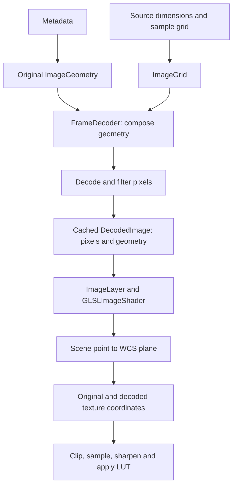

# Image coordinates from source to screen

JHV positions decoded images through one pixel-coordinate model. Metadata defines how original image
pixels map to the WCS projection plane. A decoder grid defines where decoded samples lie in those original
pixels. Composing the two gives the geometry used for filtering and texture sampling.

The original image footprint remains independent of the selected resolution. A coarser decode changes the
sample locations and texture dimensions, without moving detector masks, slits or cutout bounds.

## Pixel and texture conventions

Original image coordinates start at the upper-left edge. X increases across columns and Y follows buffer
rows. An image of size `W × H` occupies `[0,W] × [0,H]`; the center of sample `(i,j)` is `(i+0.5,j+0.5)`.
These coordinates are relative to the image, regardless of its origin in a JPEG 2000 codestream canvas.

Decoded buffers use the same edge-and-center convention within their own grids. Normalized texture
coordinates divide those buffer coordinates by the buffer width and height. Thus decoded sample `(i,j)`
is fetched at `((i+0.5)/Wr, (j+0.5)/Hr)`.

Texture row zero is addressed near texture coordinate `v=0`. Its position on screen comes from the image
geometry; no additional vertical flip belongs in the texture-coordinate calculation. FITS decoding reverses
FITS rows into this buffer order in `FITSData`, and FITS metadata converts its reference pixel accordingly.
Framebuffer coordinates, whose origin is at the lower left, are a separate space handled by the viewport
and screen transforms.

## Metadata to original image geometry

[`WcsInterpreter`](../src/org/helioviewer/jhv/metadata/WcsInterpreter.java) reads the FITS linear transform:
PC with CDELT takes precedence over CD, which takes precedence over CDELT with CROTA. It converts angular
units and retains the full matrix, including rotation and signed axis scales.

[`FitsMetaData`](../src/org/helioviewer/jhv/metadata/FitsMetaData.java) then converts the FITS convention,
where centers are integers starting at one and Y increases upward. For image height `H`, its reference
pixel in buffer coordinates is:

```text
c.x = CRPIX1 - 0.5
c.y = H - (CRPIX2 - 0.5)
```

The second matrix column changes sign to account for buffer Y. The matrix is also scaled into JHV's
projection-plane units. Observer images use solar-radius units; CAR maps use longitude and latitude in
radians, and CEA maps use longitude and the equal-area latitude coordinate. LASCO retains its instrument
rule that suppresses metadata rotation because its image pixels have already been rotated.

[`ImageGeometry`](../src/org/helioviewer/jhv/wcs/ImageGeometry.java) stores this complete linear mapping.
With pixel coordinate `P`, reference pixel `c`, matrix `A = pixelToPlane` and projection-plane point `p`:

```text
p = A · (P - c)
P = inverse(A) · p + c
```

[`WcsHeader`](../src/org/helioviewer/jhv/wcs/WcsHeader.java) stores the projection parameters: projection
kind, CRVAL, PV coefficients and plane units per radian. `unitsPerArcsec()` derives the arcsecond
conversion from that same WCS scale, including for basic/fallback images. The nonlinear conversion between
the projection plane and helioprojective angles belongs to `WcsProjection` on the CPU and the projection functions in
`imageCommon.frag` on the GPU. CRVAL participates in that conversion; it is not the pixel reference `c`.

`BasicMetaData` supplies centered geometry with uniform pixel spacing when observational metadata is
unavailable. `ImageBounds` maps original pixel corners and edge midpoints through the geometry and WCS
projection for camera bounds. `ImageGeometry.bounds` is the image-axis rectangle used for sizing; the full
matrix and projection determine the image's orientation and footprint in the scene.

## Decoder output to original pixels

[`ImageGrid`](../src/org/helioviewer/jhv/image/ImageGrid.java) describes a decoded buffer by its resolution
level, actual width and height, and first sample center in original image pixels. For the supported
JPEG 2000 grids, level `r` has spacing `s = 2^r` along both axes.

Let `F` be the first decoded sample's position in original pixels, and `Q` a decoded buffer coordinate.
The grid mapping, applied separately to X and Y, is:

```text
P = F + s · (Q - 0.5)
Q = (P - F) / s + 0.5
```

For a zero-origin JPEG 2000 image, `F=0.5`. Its reduced samples lie at `0.5`, `s+0.5`, `2s+0.5`, and so on.
This describes their positions. A reduced wavelet reconstruction does not simply copy every `s`th original
pixel value.

The actual dimensions matter. For a native image interval `[X0,X1)`, the supported decoder grid has:

```text
Xr = ceil(X0 / s)
Wr = ceil(X1 / s) - Xr
F.x = s · Xr - X0 + 0.5
```

The same calculation applies to Y. The native bridge reports the full-resolution decoder origin and each
level's actual dimensions. [`J2KNative.frame`](../src/org/helioviewer/jhv/source/J2KNative.java) converts the
native origin into `ImageGrid.firstX/firstY` at the binding boundary. Native decode requests are relative
to the level's image; the bridge adds that level's native origin when calling Kakadu.

For example, a zero-origin image of width 129 has reduced width 17 at level 3, with sample centers at
`0.5, 8.5, …, 128.5`. Stretching 17 texels uniformly between edges 0 and 129 would give different centers
and spacing. Even with exactly divisible dimensions, stretching 4096 pixels into a 2048-texel texture
would place its first center at original coordinate 1 instead of 0.5.

The native geometry reader accepts selected components with unit base sampling, zero registration and
matching grids. Components requiring resampling are rejected. Local FITS and raster sources expose an
identity grid at level 0.

## Composition, decoding and caching

`Frames.Frame.geometry()` reconciles the metadata dimensions with the source's actual full-resolution
size. If those sizes differ, `withSize` preserves the WCS matrix and reference pixel while changing the
extent. `FrameDecoder` chooses a requested level from display size and decodes the finest complete level
at that level or coarser.

On a cache miss, `FrameDecoder.decodeImage` composes the frame geometry with the selected `ImageGrid` by
calling `ImageGeometry.forGrid`. Substituting the grid equation into the original pixel mapping gives:

```text
Adecoded = s · A
cdecoded = (c - F) / s + 0.5
p = Adecoded · (Q - cdecoded)
```

The composed geometry retains its original geometry through `original`. The identity grid reuses the
original object. The filtered pixel buffer and composed geometry become one cached `DecodedImage`.



A cache hit reuses the pixels and composed geometry. It does not decode, filter, compose the geometry again
or read native geometry. Viewpoint and display adjustments are applied when rendering. Pixel ownership and
cache lifetime are described in [Image Buffer Cache](image-buffer-cache.md).

## RHEF sample positions

RHEF runs on the decode worker before texture upload. It receives the same composed `ImageGeometry` that
will accompany the output pixels. MGN and WOW do not use physical image geometry.

The original geometry locates the Sun in original pixels. For an offset observer image, it projects
helioprojective `(0,0)` onto the WCS plane and applies the inverse pixel mapping. The grid composition
carries that position into decoded pixels:

```text
sunDecoded = (sunOriginal - F) / s + 0.5
```

[`FilterRHEF`](../src/org/helioviewer/jhv/image/FilterRHEF.java) uses the lengths of the composed matrix
columns as the X and Y pixel spacings. For decoded sample `(i,j)`, its annulus radius is calculated from:

```text
dx = (i + 0.5 - sunDecoded.x) · pixelSizeX
dy = (j + 0.5 - sunDecoded.y) · pixelSizeY
radius = sqrt(dx² + dy²)
```

Consequently, the annuli follow the actual reduced sample grid, including its offset from the original
image edges. Passing the original image extent and merely dividing it by the decoded dimensions would
assign different physical positions to those samples.

## Scene coordinates to texture reads

[`ImageLayer.render`](../src/org/helioviewer/jhv/layers/ImageLayer.java) supplies current and comparison
image geometries, observer orientations, time differences and display adjustments to `GLSLImageShader`.
A user CROTA adjustment rotates the projection-plane input before the inverse pixel mapping. CRVAL
adjustments are supplied to the projection calculation. These adjustments do not rewrite cached geometry.

The mapping mode determines how each screen fragment reaches the source projection plane:

- **Orthographic** starts with the visible solar sphere or the image-plane intersection. Observer rotation
  and differential rotation select the source point. TAN uses JHV's planar shortcut, subtracting CRVAL
  from the source point's X/Y; other observer projections use helioprojective angles.
- **HPC** starts with helioprojective longitude and latitude from the displayed angular bounds.
- **Latitudinal** starts with longitude and latitude on the solar sphere and transforms them into the
  image observer's frame.
- **RadialWarp and RectWarp** construct a warped HPC plane point, then obtain helioprojective angles.

CAR and CEA source maps use the point's solar longitude and latitude directly, with CEA's equal-area
latitude conversion. The display mapping mode and the source WCS projection are separate choices.

From the resulting WCS plane point, every mode calculates original normalized image coordinates:

```text
source  = original pixel coordinate / original image dimensions
```

`GLSLImageShader` forms this affine mapping from the original `planeToPixel` and `referencePixel`
divided by the original dimensions. In
[`imageCommon.frag`](../resources/glsl/imageCommon.frag), `sourceX/sourceY` contain its two rows.
Clipping and wrapping operate on these original coordinates. Immediately before texture reads,
`getColor` converts them to decoded normalized coordinates with one `sampling` vector per image:

```text
scale   = originalSize / (step * decodedSize)
offset  = (0.5 - firstSampleCenter / step) / decodedSize
texture = source * scale + offset
```

`GLSLImageShader` derives the two-axis scale and offset from the existing grid when preparing the
uniforms. The shader stores them in `sampling.xy` and `sampling.zw`. At level 0 this is the identity.
The two-image uniform block contains 224 bytes.

Current and comparison images have independent mappings. Difference rendering transforms the same scene
location through each image's observer and WCS geometry before subtracting their sampled intensities.

## Masks, slits, wrapping and sharpening

Detector masks are sampled with `source`. Slits and image-edge clipping also use `source`.
Their positions do not depend on decoded texture size. Dithering uses this original normalized position.

Radius masks, sectors and the LASCO linear cutoff operate earlier, in the mode's solar scene or HPC plane
coordinates through `clipPlanarMasks`. They do not use decoded pixel coordinates.

For CAR/CEA longitude wrapping, `source.x` is wrapped before the sampling conversion. The conversion
therefore includes the corresponding decoded texture displacement without a separate wrapping correction.

Sharpening samples a nine-tap blur around the decoded texture coordinate, using offsets in current-buffer
texels. In difference mode, comparison offsets are multiplied by
`comparison.sampling.xy / current.sampling.xy`. This preserves the same displacement in original
normalized image coordinates even when the two decoded textures have different rounded dimensions.
Brightness, enhancement, difference contrast, sharpening, gamma, dithering and LUT conversion then produce
the fragment color.

## Cutouts

`SDOCutout` and `SampClient` use `DecodedImage.geometry().original.bounds`. With original reference
pixel `c` and original pixel spacings `px,py`, that rectangle in image-axis units with Y up is:

```text
left   = -c.x · px              width  = W · px
bottom = -(H - c.y) · py        height = H · py
```

The callers convert units to arcseconds and send the rectangle's center and size. Neither the rectangle
nor its dimensions come from the reduced texture, so progressive resolution changes cannot alter the
requested cutout.

## Regression checks

The existing tests cover separate parts of this path:

- `J2KNativeTest` compares native dimensions, grid positions and decoded pixels against Kakadu.
- `J2KReaderTest` checks geometry composition with even/odd dimensions, nonzero native origins and unequal
  pixel spacings.
- `FramesTest` checks reduced-grid RHEF, retention of original cutout geometry and reuse on a cache hit.
- `ImageRenderingTest` compares reduced ramps with full-resolution references in all display modes, checks
  detector-mask and slit coverage and reduced CAR/CEA wrapping, and compares nonlinear sharpening against
  an independent CPU reference.
- The WCS metadata and rendering validators check projection geometry against independent references.

Run the offline and GPU suites from the repository root:

```sh
ant compile
python3 extra/test/j2k/run_j2k_tests.py
python3 extra/test/run_tests.py opengl shaders --no-build
```

Native build and validation commands are in [Preparing JPEG 2000 native libraries](../extra/jpeg2000/README.md).
WCS validation is described in [the WCS validation note](wcs-validation/jhv_wcs_hpc_validation_note.md).
