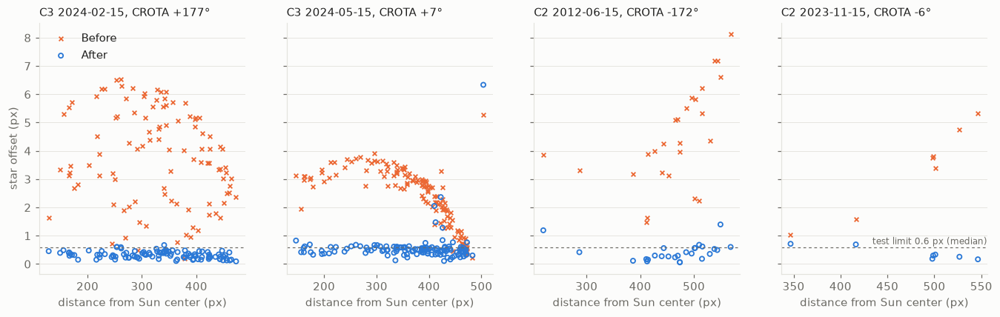
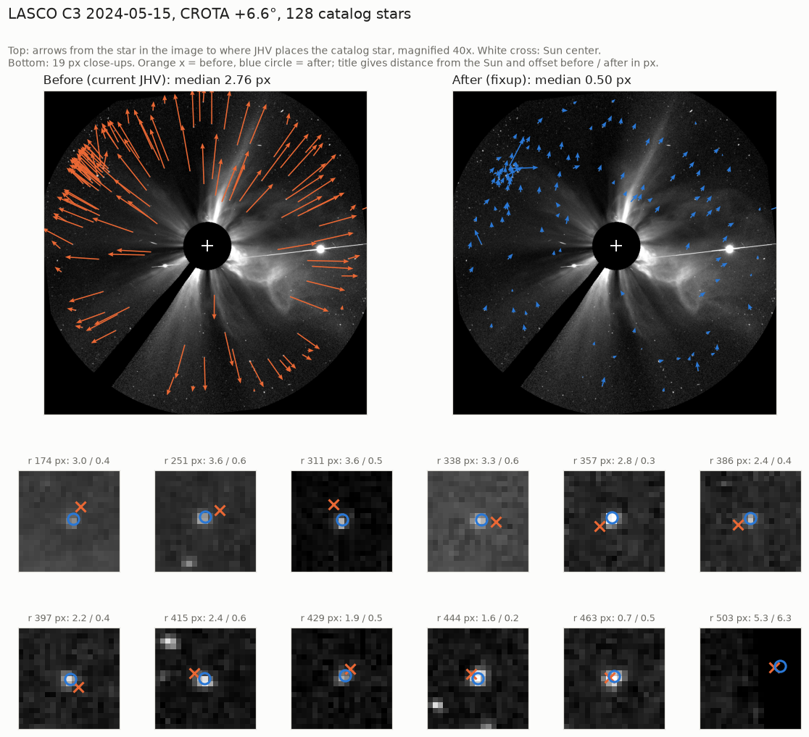
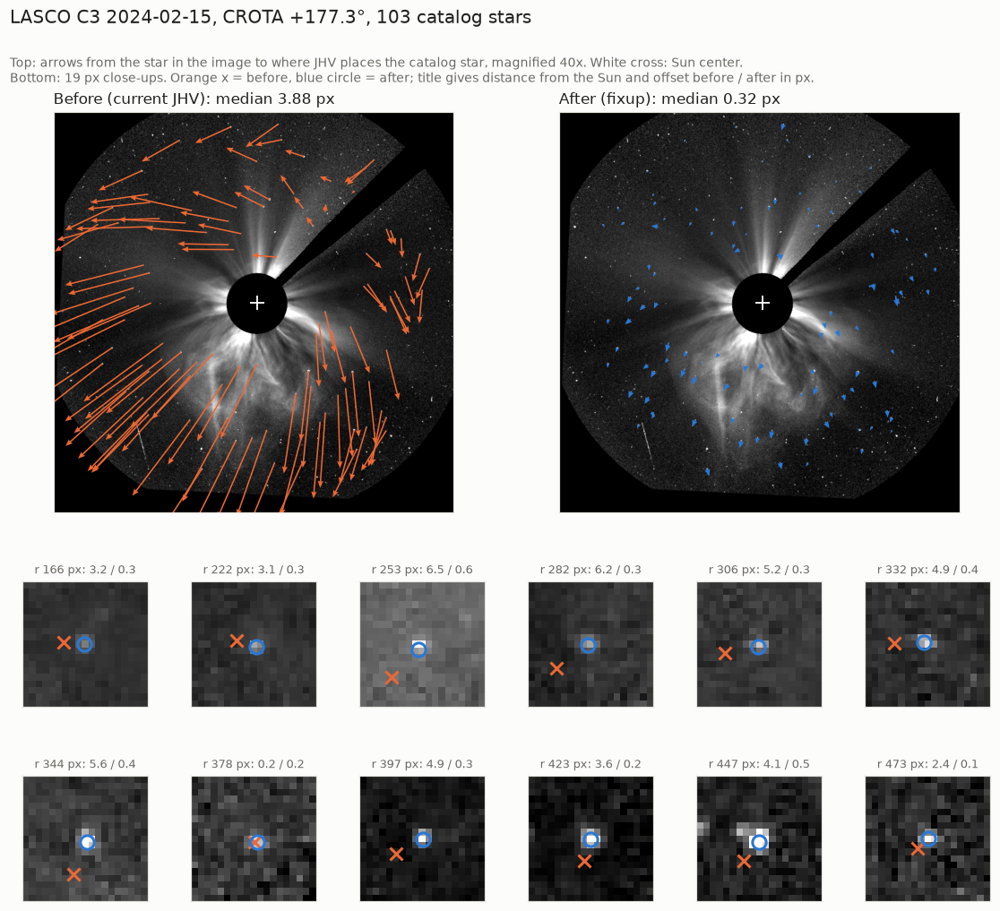
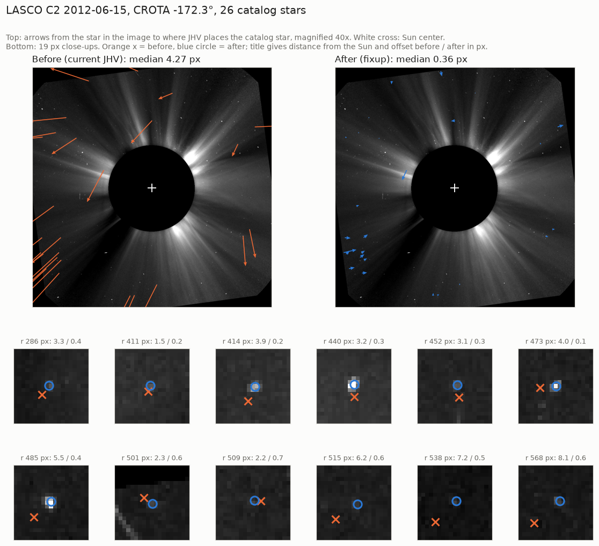
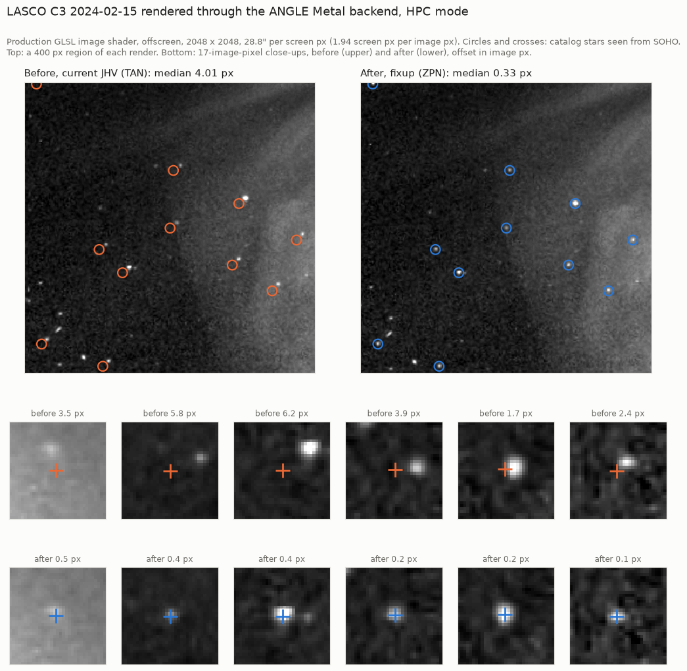
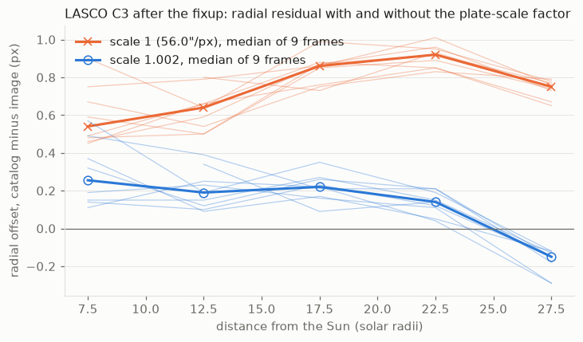

# Helioviewer LASCO JP2 geometry

JHV corrects the geometry of Helioviewer LASCO C2 and C3 JP2 headers when it reads them
(`metadata/LascoWcs.java`). For the four test-fixture frames, the median offset between catalog
stars and image stars falls from 2.8-4.3 px to 0.30-0.50 px. This note records the problem, its
cause, the correction and the evidence.

## Problem

Stars drawn by JHV miss the stars in Helioviewer LASCO JP2 frames, even with the SOHO ephemeris.
In the four fixture frames the median offset is 2.8-4.3 px, which is up to 4 arcmin in C3
(56″/px). Near the edge of the field it reaches 7-8 px. Frames taken while SOHO is rolled (CROTA
near 180°) are the worst.

## Cause

The sampled Helioviewer LASCO JP2 from 2011-05-09 on are made by the jp2gen quicklook writer
(`HV_SOURCE_PROGRAM` = `HV_LAS_C2_WRITE_HVS2` / `HV_LAS_C3_WRITE_HVS2`). It has two flaws.

1. **No distortion correction.** The LASCO optics distort radially about the occulter center.
   SolarSoft corrects this in level-1 processing (`c2_warp.pro`, `c3_warp.pro`); the quicklook
   path does not. Before the fix, catalog stars sit up to 3.7 px outside the image stars at mid
   field, falling to about zero at the edge.

   

2. **Rotation about the wrong pivot.** jp2gen turns the raw image north-up with
   `rot(img, -CROTA, 1.0, CRPIX1, CRPIX2, /pivot, /interp)`. IDL's `rot()` takes 0-based
   subscripts; CRPIX is 1-based. The pivot is therefore one pixel off in x and y. A turn near 180°
   moves the Sun about 2 px on each axis, while the header keeps a fixed CRPIX (C3 519.2/533.5,
   C2 511.2/507.5, i.e. nominal Sun centers (518.2, 532.5) and (510.2, 506.5) inferred from
   these values). Rolled frames show an extra shift of about 3 px.

   

JHV read these headers as plain TAN about CRPIX, and dropped the rotation of every LASCO image
(`CROTABlockSet` in `FitsMetaData`). For the sampled frames of this family the rotation itself is
right: the pixels are north-up within 0.03°.

### Header history and the cutoff

The sampled headers on the ROB server follow several conventions before 2011. This is an
inventory of monthly and spot samples, not a complete classification; transition dates are
approximate.

| Period | Sampled headers |
| --- | --- |
| to 2010-04 | level-1: CROTA 0, measured CRPIX, distortion already corrected |
| 2010-05 to 07 | CROTA about 180, per-image CRPIX |
| 2010-08 | CROTA 0, CRPIX = level-1 value + 1 |
| 2010-09 to 2010-10-29 15:36 | fixed CROTA (C2 0.5, C3 -0.23), nominal CRPIX; C3 roll 0.44° off |
| 2010-10-29 22:31 to 2011-04-20 | jp2gen turned the wrong way; JHV shows these frames turned by 2 x CROTA |
| 2011-04-22 to 29 | C3 images inverted by about 180° relative to the header |
| 2011-05-02 to 05-04 17:00 | C3 right, C2 CROTA about 180° off |
| 2011-05-09 on | consistent jp2gen quicklook headers |

No frames were found between C2 2011-05-04 17:00:07 and 2011-05-09 00:00:07, or C3
2011-05-04 16:54:07 and 2011-05-09 00:06:06 (ROB samples, GSFC nearest-frame query). The cutoff,
2011-05-05T00:00Z, is a choice inside this gap. `HV_QUICKLOOK` cannot tell the families apart;
the date can.

## Correction

`FitsMetaData` calls `LascoWcs.adapt` for `INSTRUME` LASCO with an `HV_QUICKLOOK` key, between the
generic header translation (`WcsInterpreter.header`) and the WCS construction
(`WcsInterpreter.solve`).

**C2 and C3 from 2011-05-05T00:00Z.** The WCS is rewritten as a zenithal polynomial (ZPN) about the
occulter center, which carries SolarSoft's distortion model:

- SolarSoft model (`distortion_coeffs.pro`, `c2_distortion.pro`, `c3_distortion.pro`):
  raw radius = r + r (c0 + c1 mm² + c2 mm⁴), with mm = 0.021 r and r in pixels.

  | | c0 | c1 | c2 | occulter center (0-based raw px) |
  | --- | --- | --- | --- | --- |
  | C2 | 0.0051344125 | -0.00012233862 | 1.0978595e-7 | (512.634, 505.293) |
  | C3 | -0.0151657 | 0.000165455 | 0 | (516.456, 531.132) |

  The C3 center is the last entry of `c3_occltr_cntr.dat` (2000-10-20); the C2 center is from
  `occltr_cntr.pro` and `occulter_center.dat`.
- Pivot P = (CRPIX1, CRPIX2) taken as 0-based; R = counterclockwise rotation by CROTA.
  Sun after the turn: S′ = P + R(-1, -1). Occulter after the turn: O′ = P + R(O - P).
- `CTYPE` = `HPLN-ZPN` / `HPLT-ZPN`, `CRPIX` = O′ + 1, `CRVAL` = (O′ - S′) CDELT / A, `CROTA2` = 0.
  CRVAL is a near-center approximation, not an exact inversion of the radial mapping.
- With s = CDELT in rad/px, k = 0.021/s, A = 1 + c0, B = c1 k², C = c2 k⁴:
  `PV2_1` = A, `PV2_3` = A/3 + B, `PV2_5` = 2A/15 + B + C.
  This is A tan θ + B tan³ θ + C tan⁵ θ expanded to fifth order. Dense comparisons with the exact
  radial model give differences of about 0.01 px (C2) and 0.052 px (C3) within the tested fields.
- C3 `CDELT` is multiplied by 1.002, a measured factor (see below). C2 keeps 11.9″/px.
- The rewrite assumes what all 54 sampled post-cutoff headers have: 1024² pixels, CDELT positive,
  equal on both axes and in arcseconds, a `CROTA` key, and no PC or CD matrix.

**Before the cutoff, and other detectors.** LASCO headers with the Helioviewer key only get
`CROTA2` = 0. On 114 sampled pre-cutoff headers this reproduces the former geometry within
floating-point roundoff. Headers with a PC or CD matrix would differ.

**Removed.** `CROTABlockSet` and the `pixelsAlreadyRotated` flag of `ImageGeometry`. A LASCO FITS
file without Helioviewer keys now keeps its own WCS, including CROTA or PC.

**C2 square cutoff.** `cutOffValue` is measured from the Sun pixel instead of the reference pixel.
For frames before the cutoff the two are the same. After it the square is retained approximately:
its half-size on the rolled C2 fixture changes from 491.5 to 493.3 px.

The occulter reference makes CRVAL nonzero, which cutout regions take into account since
92c535ddcc.

## Results

Median star offset in image pixels, through JHV's inverse WCS, all matched stars:

| Frame | CROTA | Stars | Before | After |
| --- | --- | --- | --- | --- |
| C3 2024-02-15 | +177° | 103 | 3.88 | 0.32 |
| C3 2024-05-15 | +7° | 128 | 2.76 | 0.50 |
| C2 2012-06-15 | -172° | 26 | 4.27 | 0.36 |
| C2 2023-11-15 | -6° | 7 | 3.77 | 0.30 |

Eleven further frames outside the test fixture (C3 2011-2024, C2 2024), same metric, give medians
of 0.22-0.42 px (C3) and 0.41-0.86 px (C2) after, against 1.68-4.14 px before. Three of these C3
frames (2012-06, 2018-06, 2023-11) were among those used to measure the C3 plate scale.

### Through the image shader

The same frames rendered offscreen through the production GLSL image shader on ANGLE's Metal
backend, HPC mode, 2048² render, about 1.9 screen px per image px. Catalog positions are placed
from the HPC screen mapping alone. Median star offset in image pixels:

| Frame | Stars | Before | After | Median absolute difference in offset magnitudes, shader vs CPU |
| --- | --- | --- | --- | --- |
| C3 2024-02-15 | 103 | 4.01 | 0.33 | 0.03 |
| C3 2024-05-15 | 127 | 2.76 | 0.49 | 0.02 |
| C2 2012-06-15 | 20 | 3.98 | 0.31 | 0.02 |

A star is excluded when its search window (9 image px) touches a black pixel in either render
(the C2 square mask, the image's own masks), or when the search and centroid windows do not fit
inside the render.

A direct probe of the shader's coordinate code agrees with the CPU within about 0.001 px.

## C3 plate scale

SolarSoft's `subtense.pro` gives 56.0″/px for C3. With SolarSoft's distortion applied, a free fit
of the plate scale to the stars gives a factor of 1.00207, 1.00213, 1.00193, 1.00209, 1.00202 and
1.00195 on six frames from 2012 to 2025, rolled and unrolled: 1.00203 with a frame-to-frame
standard deviation of 0.00008 (about 0.04 px at the field edge). No time dependence is resolved in
these six fits.

Without the factor, the signed radial residual grows outward to about +0.9 px. With it, the median
over nine frames is +0.26, +0.19, +0.22, +0.14 and -0.15 px in the 5-10, 10-15, 15-20, 20-25 and
25-30 Rsun bins; single frames range from +0.57 px inside to -0.29 px at the edge. The model does
not capture this shape.

Limits of the factor:

- It is degenerate with SolarSoft's c0 at first order: both scale the linear ZPN term. The fits
  keep SolarSoft's coefficients fixed and do not show which calibration is off.
- It depends on SolarSoft's distortion amplitude. Scaling the distortion by 1.2 moves the fit to
  about 1.0016 with comparable residuals; these fits do not establish the best amplitude.
- It has not been compared with a published C3 plate-scale calibration.

## Verification

- `WcsInterpreterTest` reads four real frames (`extra/test/data/lasco_stars.json`) through
  `FitsMetaData`. For each frame it requires the median star offset (angular offset over CDELT)
  below 0.6 px and the 90th percentile below 1 px; the current values are 0.30-0.50 px and
  0.47-0.72 px. With the old reading the test fails (3.87 px on the rolled C3 frame). On the 2026
  C3 fixture it also checks ZPN at exactly 2011-05-05T00:00Z and plain TAN one millisecond before;
  moving the cutoff by 1 ms makes it fail.
- `extra/test/wcs/generate_lasco_stars.py` writes the fixture from decoded JP2 (ROB server,
  `opj_decompress`) and SOHO positions (swhv.oma.be). These inputs are not in the repository. It
  matches stars through the header CRPIX and CDELT and a fitted similarity transform, independent
  of the geometry under test, and skips frames with too few matches. Regenerating it from the
  retained inputs gives identical JSON.
- The WCS metadata comparison suite passes all 42 cases, including 28 generated cases checked
  directly against Astropy. Its former `lasco_transform_suppression` case is now
  `lasco_native_rotation`.

## Limits

- Frames before 2011-05-05 are unchanged; those from 2010-10-29 to 2011-04-20 still appear turned
  by 2 x CROTA.
- Remaining C3 offsets: see the plate-scale section. Some matched pairs in the fixture reach about
  6.3 px, likely false detections or blends (possibly the Pleiades in 2024-05).
- Post-cutoff headers outside the sampled family are not supported: a PC or CD matrix, a missing
  `CROTA` key (reading fails), CDELT in other units than arcseconds, and `HV_QUICKLOOK` = FALSE,
  which is corrected like TRUE.
- Not checked in the running application, or in the Orthographic and warp modes.

## References

- jp2gen: [hv_las_c2_write_hvs2.pro](https://github.com/Helioviewer-Project/jp2gen/blob/54c72d5651fbd60d46c695cc954012915eda5914/idl/soho/lasco/hv_las_c2_write_hvs2.pro#L85),
  [hv_las_c3_write_hvs2.pro](https://github.com/Helioviewer-Project/jp2gen/blob/54c72d5651fbd60d46c695cc954012915eda5914/idl/soho/lasco/hv_las_c3_write_hvs2.pro#L109)
- IDL [ROT](https://www.nv5geospatialsoftware.com/docs/ROT.html)
- SolarSoft LASCO, `https://hesperia.gsfc.nasa.gov/ssw/soho/lasco/idl/`:
  `data_anal/c2_distortion.pro`, `data_anal/c3_distortion.pro`, `data_anal/c2_warp.pro`,
  `data_anal/c3_warp.pro`, `data_anal/occltr_cntr.pro`, `convert/distortion_coeffs.pro`,
  `convert/occulter_center.dat`, `convert/c3_occltr_cntr.dat`, `convert/subtense.pro`
